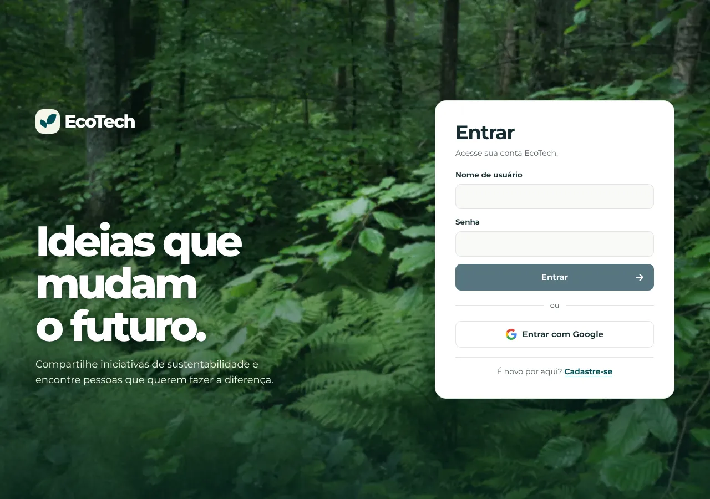
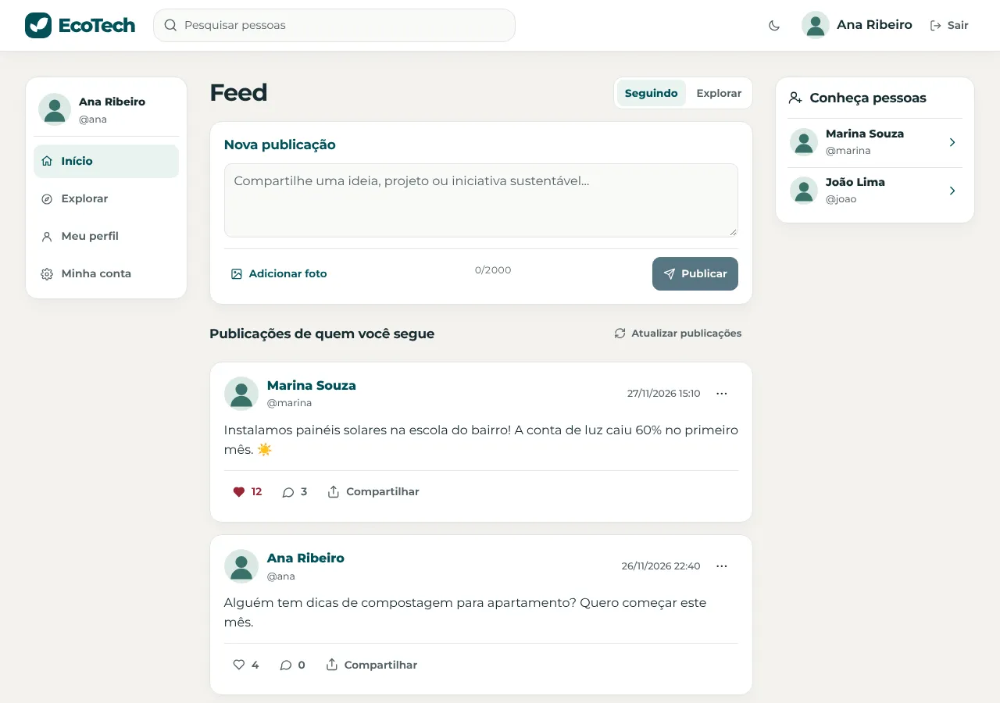
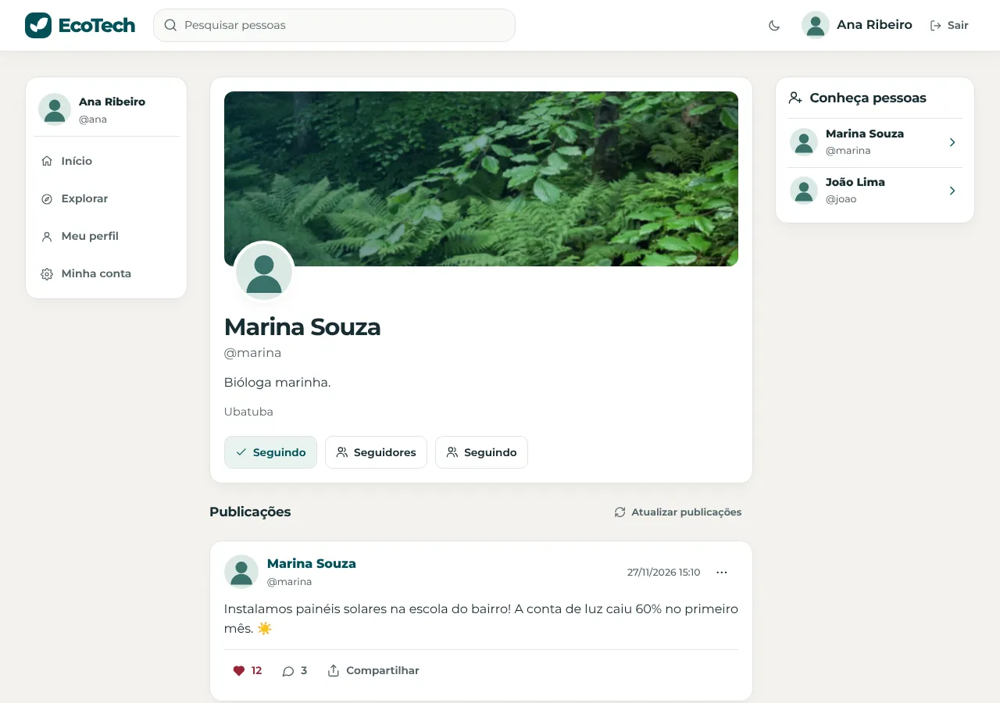
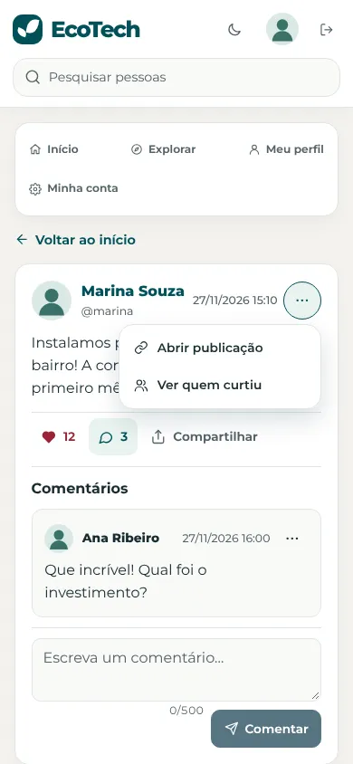

# EcoTech


[](https://github.com/lucaszimmerman/ecotech-angular/actions/workflows/ci.yml)

Rede social para quem quer compartilhar iniciativas de sustentabilidade e encontrar pessoas que fazem a diferença. Este repositório é o **frontend em Angular**; a API em Spring Boot fica em [ecotech-spring-api](https://github.com/lucaszimmerman/ecotech-spring-api) e está publicada no Render.

**[Acessar a EcoTech ↗](https://ecotech-angular.vercel.app)** · [Swagger da API](https://ecotech-spring-api.onrender.com/swagger-ui/index.html)

> No primeiro acesso a API pode levar cerca de um minuto para acordar (Render Free). A tela mostra um aviso enquanto isso.



## Funcionalidades

- **Conta:** cadastro, login com usuário e senha ou com Google, sessão com JWT e página "Minha conta".
- **Boas-vindas:** depois do cadastro, um passo a passo opcional para cidade, site, bio, foto de perfil e capa.
- **Feed:** publicações de quem você segue (aba *Seguindo*) ou de toda a rede (aba *Explorar*), com paginação e aviso de novidades.
- **Publicações:** texto de até 2000 caracteres com imagem opcional; editar, excluir, curtir, ver quem curtiu, comentar e copiar o link.
- **Perfis:** capa, foto, bio, cidade e site; seguir e deixar de seguir; listas de seguidores e seguindo.
- **Busca de pessoas** na barra superior, com resultados enquanto você digita.
- **Tema claro e escuro**, layout responsivo e navegação por teclado (menus fecham com Esc, foco visível em todos os controles).

## Telas

| Feed | Perfil | Celular |
| --- | --- | --- |
|  |  |  |

## Tecnologias

| Camada | Escolha |
| --- | --- |
| Framework | Angular 22 com NgModules e o novo control flow (`@if`, `@for`) |
| Linguagem | TypeScript 6 em modo `strict` |
| Estado e HTTP | RxJS 7, `HttpClient` com interceptor de autenticação |
| Estilos | CSS puro com variáveis (sem biblioteca de UI), fonte Montserrat local |
| Ícones | SVG inline gerados a partir de um mapa único (`shared/icons.ts`) |
| Testes | Karma + Jasmine, mais scripts de smoke test para API e navegador |
| Hospedagem | Vercel (frontend) e Render (API) |

## Arquitetura

O app segue um fluxo em camadas. Cada camada só conhece a de baixo:

```
pages / components   →   services   →   data/repositories   →   HttpClient
     (telas)            (casos de uso)     (contratos HTTP)
```

- **pages:** telas ligadas a rotas (`home`, `perfil`, `post-page`, `login`, `cadastro`, `welcome`). Montam o layout e delegam o trabalho.
- **components:** blocos de tela com estado próprio (`post`, `posts`, `comments`, `share`, `nav-bar`, `left-bar`, `right-bar`, `update`).
- **services:** coordenam as operações que a interface precisa (autenticação, publicações, curtidas, seguidores, tema).
- **data/repositories:** um repository por recurso da API, com as URLs e os tipos de cada endpoint. É o único lugar que conhece o formato HTTP.
- **data:** modelos da API (`api-models.ts`), sessão e interceptor (`session.ts`), aviso de requisições lentas (`api-activity.ts`) e URLs de mídia.
- **shared:** peças reutilizáveis sem regra de negócio (componentes de interface, pipes, helpers de estado).

### Estrutura de pastas

```
src/
├── app/
│   ├── components/        # post, posts, comments, share, nav-bar, left-bar, right-bar, update
│   ├── data/
│   │   ├── repositories/  # auth, post, comment, like, relationship, user
│   │   ├── api-models.ts
│   │   ├── api-activity.ts
│   │   └── session.ts
│   ├── pages/             # home, perfil, post-page, login, cadastro, welcome
│   ├── services/          # auth, post, comment, likes, relationship, user, dark-mode, api.config
│   ├── shared/            # icon, menu, char-count, person-link, status, pipes, nav-links
│   ├── app-routing.module.ts
│   └── app.module.ts
├── assets/                # fontes, imagens e avatar padrão
├── index.html             # metas de configuração
└── styles.css             # tema, layout e controles
```

## Créditos

- Foto de fundo da tela de acesso e da capa padrão: [Beech and ferns in Gullmarsskogen](https://commons.wikimedia.org/wiki/File:Beech_and_ferns_in_Gullmarsskogen.jpg), de W.carter, via Wikimedia Commons, em domínio público (CC0).
- Fonte [Montserrat](https://fonts.google.com/specimen/Montserrat), sob a SIL Open Font License.
